# 🛡️ AI 网络安全管家

> **嵌入式硬件 + 桌面安全监控 + AI Agent + 纵深防御 四位一体的开源安全守护系统**
>
> ESP32 物理终端实时显示安全状态 · LangGraph 编排的 AI Agent 智能分析威胁
> 运行时自审计防篡改 · 敏感工具执行前人工批准
> 下载前置扫描 + 网络隔离 + Windows 防火墙 · 零件淘宝可买，成本约 ¥55

<p align="center">
  
  
  
  
  
</p>

---

## 📸 效果预览

### ESP32 物理终端

设备外接 0.96" OLED 显示屏，通过"安小盾"二次元角色展示安全状态：

```
┌──────────────────────┐       ┌──────────────────────┐
│ ▂▃▄▅ ●           SAFE│       │ ▂▃▄▅     DANGER│
│────────────────────│       │══════════════════════│
│                      │       │                      │
│   (･ω･)              │       │   (>_<)              │
│   安小盾 守护中...    │       │   检测到威胁!        │
│                      │       │                      │
│   FW:ON  AV:ON       │       │   ⚠ DANGER ⚠        │
│   连接: 42  威胁: 0   │       │   威胁: 3  连接: 55  │
└──────────────────────┘       └──────────────────────┘
   安全模式 (表情屏)              危险模式 
```

### PyQt5 桌面 GUI

极简暗色主题桌面应用，实时安全概览 + AI 对话窗口。

### CLI Agent

```bash
$ python agent_cli.py "全面扫描我的网络安全"

  [tool] scan_network()
  → 42 个活跃连接, 0 个可疑 IP
  [tool] scan_processes()
  → 0 个可疑进程
  [tool] check_firewall()
  → 防火墙: 开启 | Defender: 开启

🛡️ 系统状态: 安全
当前没有发现活跃威胁。防火墙和 Defender 均正常运行。
网络连接数正常，无可疑进程。
```

---

## 🏗️ 系统架构

```
┌──────────────────────────────────────────────────────────────┐
│                     你的电脑 (Windows)                         │
│                                                              │
│  ┌────────────────────────────────────────────────────────┐  │
│  │              PC Agent — 安全监控引擎                     │  │
│  │                                                        │  │
│  │  Network       Process       Firewall      Security    │  │
│  │  Monitor       Monitor       Checker       Monitor     │  │
│  │  (psutil)      (psutil)      (netsh+PS)    (EventLog)  │  │
│  │     │              │             │             │       │  │
│  │     └──────────────┼─────────────┼─────────────┘       │  │
│  │                    ▼             ▼                      │  │
│  │              GuardianController                         │  │
│  │           (状态管理 + 安全等级计算)                       │  │
│  │     │           │            │                          │  │
│  │     ▼           ▼            ▼                          │  │
│  │  Device    Character      LLM                          │  │
│  │  Bridge    Manager        Client                       │  │
│  │  (Serial   (安小盾角色     (DeepSeek/                    │  │
│  │   /WiFi)   表情+台词)      智谱/硅基)                     │  │
│  │     │                                                  │  │
│  └─────┼───────────────────────────────                    │  │
│        │ USB Serial                                        │  │
│        ▼                                                   │  │
│  ┌──────────────────────────┐                              │  │
│  │   ESP32 + OLED/TFT        │                              │  │
│  │   角色动画 + 安全仪表盘    │                              │  │
│  └──────────────────────────┘                              │  │
│                                                              │
│  ┌────────────────────────────────────────────────────────┐  │
│  │           AI Agent — LangGraph 状态图编排                │  │
│  │                                                        │  │
│  │   prepare ──▶ agent ─┬─(无 tool_calls)────────▶ END    │  │
│  │      │          ▲    └─(有 tool_calls)──▶ approval      │  │
│  │      │          │                            │          │  │
│  │      │          └──────── tools ◀────────────┘          │  │
│  │      │                     (interrupt 等人工批准)        │  │
│  │      │                                                  │  │
│  │  技能匹配 + KB 检索        SqliteSaver 检查点 (可续跑)    │  │
│  │                                                        │  │
│  │              Tool Registry (33 个工具)                   │  │
│  │  ┌─────────┐ ┌──────────┐ ┌──────────┐ ┌───────────┐  │  │
│  │  │Security │ │Defender  │ │OTX Threat│ │NVD CVE    │  │  │
│  │  │Sandbox  │ │Scanner   │ │Intel     │ │Lookup     │  │  │
│  │  │(白名单+  │ │(PS CMD)  │ │(免费API) │ │(免费API)  │  │  │
│  │  │Job Obj) │ │          │ │          │ │           │  │  │
│  │  └─────────┘ └──────────┘ └──────────┘ └───────────┘  │  │
│  │                                                        │  │
│  │  MCP Client (外部工具) / MCP Server Mode (暴露给外部)    │  │
│  │  Knowledge Base (Markdown 事实源 + 中文 BM25 检索)         │  │
│  └────────────────────────────────────────────────────────┘  │
└──────────────────────────────────────────────────────────────┘
```

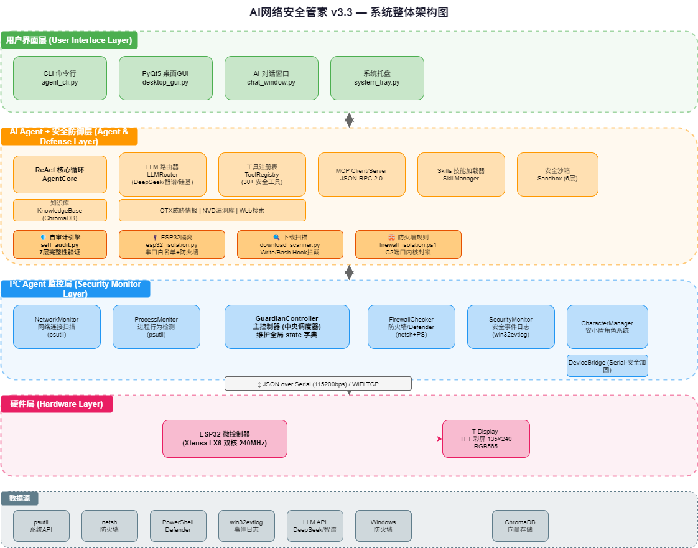

---

## 🎯 核心功能

### 🔒 安全监控 (PC Agent)
- ✅ **网络监控** — 活跃连接、可疑 IP 段识别、C2/后门端口检测 (21 个恶意端口)
- ✅ **进程监控** — 黑客工具特征检测 (32 条黑名单)、CPU/内存异常告警
- ✅ **终止可疑进程** — `terminate_process` 工具，**执行前必过审批闸门**。
  另有一层不依赖用户批准的硬保护：`lsass` / `csrss` / `winlogon` 等系统关键进程
  即使点了「批准」也一律拒绝——用户批准了不等于这件事该做。
- ✅ **防火墙检查** — netsh + PowerShell + 服务查询三级降级、30s 缓存防抖
- ✅ **安全事件** — Windows EventLog 分析 (14 种可疑 EventID)
- ✅ **Defender 状态** — 实时杀毒状态 + 快速/全盘扫描

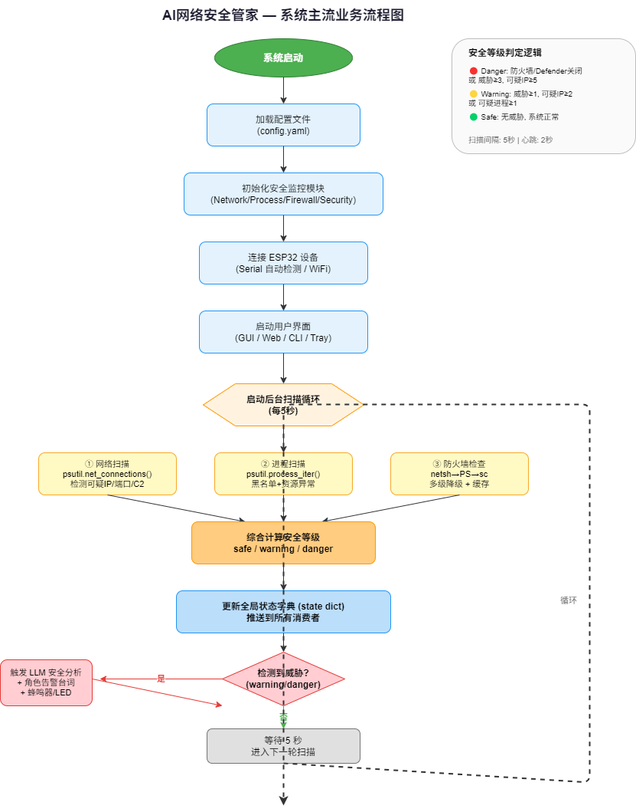

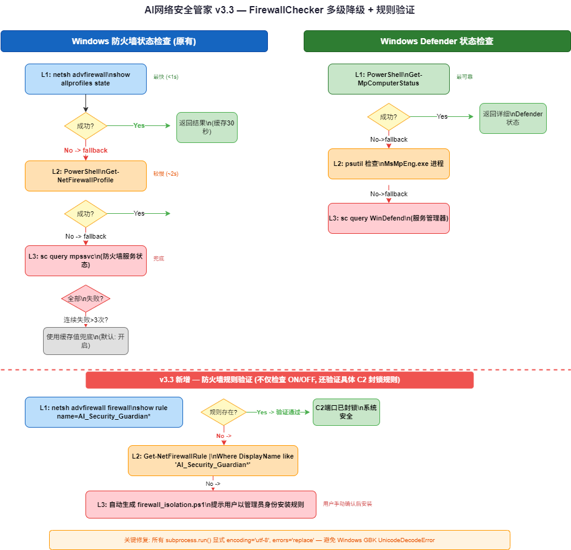

### 🤖 AI Agent (LangGraph 编排)
- ✅ **状态图编排** — `START → prepare → agent ─┬→ END / └→ approval → tools → agent`
  （见下方「Agent 编排」一节）
- ✅ **多模型支持** — DeepSeek / 智谱 / 硅基流动，按 priority 自动故障转移
  （配了多家才会真正发生转移；只配一家时无从转移）
- ✅ **33 个内置工具** — 安全扫描、威胁情报、CVE 查询、命令沙箱、自审计、ESP32 隔离、下载扫描
- ✅ **人工审批闸门** — `run_command` / `install_skill` / `recommend_mcp_server`
  执行前暂停等用户确认（CLI 命令行确认，GUI 弹对话框）
- ✅ **崩溃可恢复** — 图状态落在 `data/` 下的 SQLite，审批中断后重启用同一
  `thread_id` 可续跑
- ✅ **逐 token 流式输出** — GUI 与 CLI 都是逐字显示
- ✅ **CLI 对话模式** — `/tools` `/save` `/kb` `/run` `/model` `/clear` 等斜杠命令

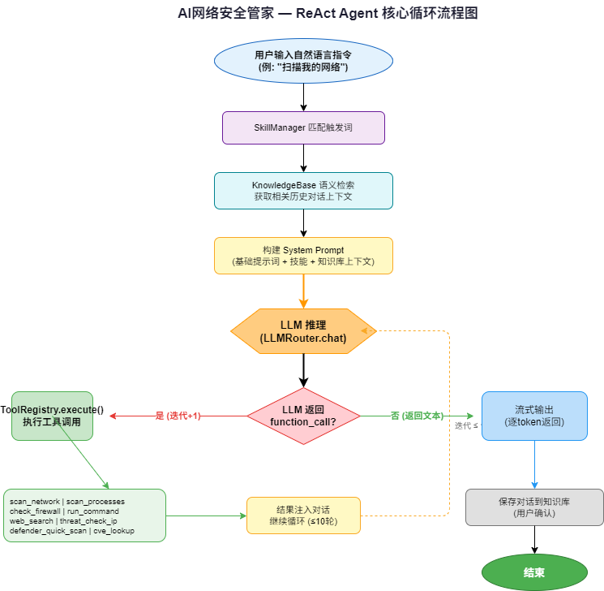

### 🌐 威胁情报
- ✅ **AlienVault OTX** — IP/域名/文件哈希信誉查询 (免费 API，5 分钟缓存)
- ✅ **NIST NVD** — CVE 漏洞查询与关键词搜索 (免费 US 政府 API)
- ✅ **DuckDuckGo** — 无追踪安全搜索 + 网页抓取

### 📟 ESP32 硬件终端
- ✅ **双屏设计** — 表情屏 (颜文字角色) + 仪表盘 (安全数据)，按键/指令切换
- ✅ **角色引擎** — "安小盾" 二次元角色
- ✅ **通信** — USB Serial (自动检测 COM 口)
- ✅ **硬件** — TTGO T-Display (TFT 彩屏)

### 🔌 MCP 协议 (Model Context Protocol)
- ✅ **MCP Client** — 连接外部 MCP Server，自动发现工具 (stdio + HTTP)
- ✅ **MCP Server** — 将 Guardian 安全工具暴露给 Claude Code 等外部客户端
- ✅ **JSON-RPC 2.0** — 符合 MCP 2024-11-05 规范

### 📦 Skills 技能系统
- ✅ **拖放安装** — `.md` 文件放入 `skills/` 目录自动加载
- ✅ **触发匹配** — 用户输入匹配技能触发词，自动注入系统提示词。
  连续子串优先，中文允许修饰语插在词中间（「扫描我的网络」→ `network-scan`）；
  多个技能同时命中时取**得分最高**者，而不是迭代顺序里的第一个
- ✅ **8 个内置技能** — 全面审计、网络扫描、进程检查、进程白名单、
  勒索软件检测、误报忽略、自审计、下载安全
- ✅ **用户自定义** — `skills/user/` 目录支持个人技能
  > 只有**带 `triggers` 的 .md 才算技能**。没有触发器的文件永远无法被激活，
  > 加载它们只会白占系统提示词的位置，因此会被跳过（启动日志里会列出跳过了哪些）。
  > 技能包里的 `references/*.md` 资料文件也走这条规则。

### 🧠 知识库系统
- ✅ **纯中文 BM25** — 自研 CJK bigram 分词 + BM25，精确命中进程名、端口号、CVE 编号等术语
- ✅ **Markdown 事实源** — 对话存为可读的 `.md`，索引是进程内派生物，删掉可按需重建
- ✅ **零外部服务** — 不需要嵌入模型、GPU、向量库或容器；启动即可用
- ✅ **可解释** — 命中就是词面命中，不需要排查“向量为什么没召回”
- ✅ **越用越聪明** — 每次对话自动积累，检索结果注入新对话

> 本项目刻意不做向量检索：语料是本地单人的几十~几千条对话，
> BM25 的词面召回更贴合安全场景，也省掉了嵌入模型的显存与冷启动成本。
> 嵌入模型与向量库只保留在另一个 RAG 项目中，本项目不加载、不连接。

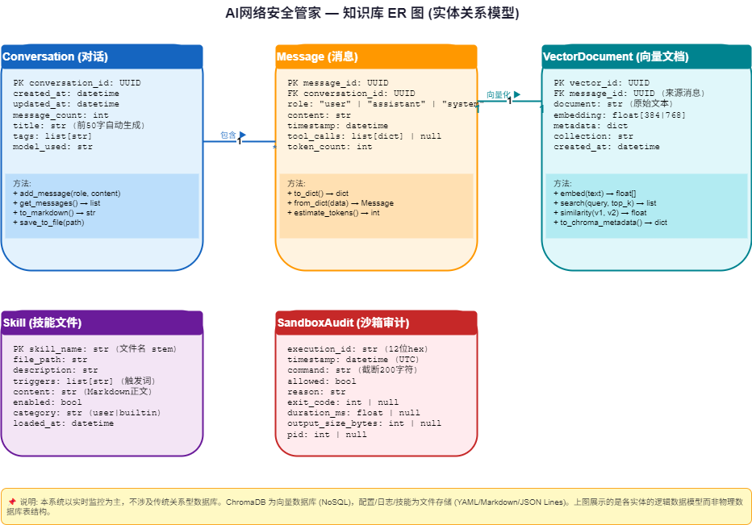

### 🔒 安全沙箱
`run_command` 的执行路径上实际生效的是这几层：

- ✅ **命令白名单 (21 条)** — 白名单之外的命令一律拒绝（`SandboxExecutor.execute` 第一层）
- ✅ **命令黑名单 (36 条模式)** — 破坏性操作、管道、重定向、管理类命令
- ✅ **Job Object 进程围栏** — `KILL_ON_JOB_CLOSE`（守护进程崩溃时连带杀掉所有
  子进程，不留孤儿）+ 64MB 进程内存上限 + 桌面隔离
- ✅ **超时与输出截断** — 默认 30s、16KB
- ✅ **审计日志** — 每次执行落盘（`pc_agent/sandbox_audit.log`）

> **诚实说明**：早期文档写的「6 层隔离 …… Restricted Token …… 文件守卫 …… fail-closed
> 任一层失败默认拒绝」并不成立 —— `Restricted Token` 层**从未实现**（0 行代码），
> `ALLOWED_WRITE_PATHS` 文件守卫定义了但零引用。这些已在自审计中如实标记为「未实现」，
> 而不是像以前那样硬编码成 `passed: True`。
>
> 另外，Job Object 层是**尽力而为**：如果本进程已经身处另一个不允许 breakaway 的
> 作业里（IDE 内置终端、CI 里很常见），会记 warning 并降级为无围栏，而不是拒绝执行。

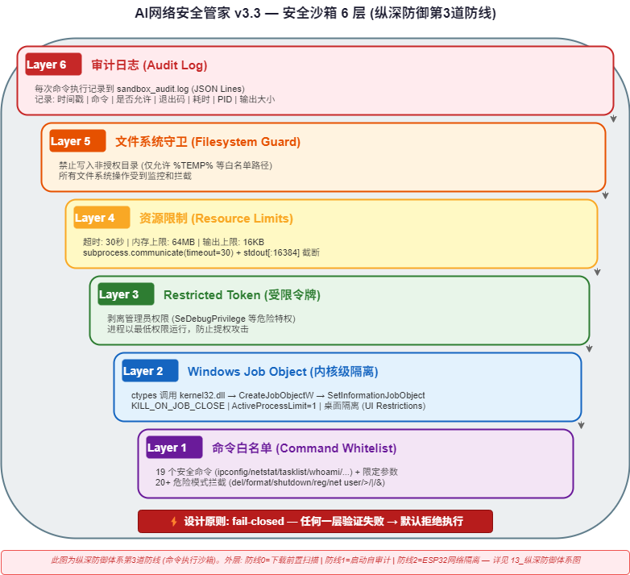

### 🛡️ 运行时自审计
分两档，用途不同：

- ✅ **启动自检 (`quick_check`, ~1s)** — 每次启动自动跑。检查关键文件是否存在、
  做代码注入扫描、查配置与解释器/环境。**不含** SHA256 哈希清单、不含依赖审计
  （那些在完整审计里）。
- ✅ **完整审计 (`--full`, ~3s)** — 文件哈希 → 依赖审计 → 配置守卫 → 运行时完整性
  → 代码注入扫描 → 网络自查 → 沙箱测试，共 6 项。
- ✅ **完整性清单** — SHA256 基线，`python generate_integrity_manifest.py` 重建
- ✅ **0-100 评分** — 综合评分；沙箱任一层不通过扣 50 分
- ✅ **启动熔断（opt-in）** — 配置 `agent.lockdown_on_critical: true` 或加 `--lockdown`
  后，自检发现 CRITICAL 问题就**拒绝启动**并以退出码 2 收场。默认关闭——
  用户可能正在调试，无脑拒绝启动会很烦人。

> **诚实说明**：早期文档写的是「7 层审计」。
> - 第 7 项「沙箱测试」里的 **Restricted Token 层从未实现**（硬编码 `passed: True`，
>   现已改为如实报告）。实际可验证的是 6 项。
> - 那句「严重问题熔断告警」当时**没有对应代码** —— 启动时发现问题只告警、
>   不阻止启动。现在补上了真正的熔断开关（默认关闭，见上）。
> - 代码注入扫描此前用 `if pattern in content` 拿正则**源码文本**做字面匹配，
>   双向失效（真实注入 0 命中、却把模式定义本身当命中，实测报 8 条假 CRITICAL）。
>   已改为真正则匹配，并以「干净代码树必须 0 命中」作为测试不变量。
>
> 因此评分现在会比以前**低**（当前约 48 分，唯一的关键失败是「受限令牌层未实现」）——
> 那是真实情况的反映，而不是退步。

### 🔌 ESP32 网络隔离 (v3.3 新增)
- ✅ **Serial 纯显示** — 默认仅 USB Serial 通信，ESP32 无法触网
- ✅ **命令白名单** — 6 种合法指令，连续 10 次非法即熔断
- ✅ **速率限制** — 每秒最多 20 条，防串口洪泛攻击
- ✅ **外泄防护** — 串口读到的设备数据只允许流向本地日志；
  `SerialEgressGuard.check_egress_safety` 已接入串口读取循环，改动成网络转发会被拦下
- ✅ **Windows 防火墙** — 内核级封锁 C2 端口 (4444/31337/6666 等)
- ✅ **固件指纹** — 设备握手走结构化指纹校验（要求 JSON 里出现
  `status=ready` / `type` / `fingerprint` 三者之一），不再只是 `'ready' in s` 子串匹配

### 🔍 下载前置扫描 (v3.3 新增)
- ✅ **Skill 安装前扫描** — 提示注入、隐藏 Unicode、代码执行模式检测；命中即**拒绝安装**
- ⚠️ **MCP 推荐前扫描** — 会扫描并告警，但**只告警不拦截**（`recommend_mcp_server`
  本来也只输出配置片段，不自动安装；真正的把关是用户手工 review）
- ✅ **curl|bash 拦截** — 管道到 shell 的命令直接拒绝
- ✅ **Claude Code Hook** — Write/Bash 操作自动触发扫描（`.claude/hooks/`）

### 💻 用户界面 (4 种)
| 界面 | 启动方式 | 说明 |
|------|----------|------|
| CLI 命令行 | `python main.py` | 彩色日志，适合服务器/后台 |
| PyQt5 桌面 GUI | `python main.py --gui` | 暗色极简主题，状态卡片 |
| AI 对话窗口 | GUI 内打开 | 流式对话，快速操作按钮 |
| 系统托盘 | 自动 (GUI 内置) | 状态色图标，最小化到托盘 |

---

## 🕸️ Agent 编排 (LangGraph)

### 为什么在已有自研 ReAct 的情况下引入 LangGraph

这个项目原本手写了两套 ReAct 循环 —— 一套在 `agent/core.py`（CLI 用），
一套在 `pc_agent/chat_window.py`（GUI 用），各写一份 system prompt、各自维护历史。
由此带来两个真实缺陷：

1. **两套实现必然漂移**。技能系统只挂在 CLI 那一套上，GUI 完全用不到 ——
   用 installer 装上的技能在 GUI 里永远不生效。
2. **危险工具没有人工闸门，而且做不出来**。工具执行跑在 QThread 上，所有 UI
   都在主线程，两者之间没有任何确认握手 —— 想在执行前弹个框，没有可用的机制。

引入 LangGraph 直接解决这两件事：两条链路合成同一张状态图；
审批用 `interrupt()` 表达，图自己会把状态存下来、等外部回答后再续跑。

### 图结构

```
START → prepare → agent ─┬─(无 tool_calls)──────────────────→ END
                         └─(有 tool_calls)→ approval → tools ──┘
                                              ↑
                                    全图唯一的 interrupt()
```

| 节点 | 职责 |
|---|---|
| `prepare` | 技能触发匹配 + 知识库检索（带超时预算） |
| `agent` | 组装系统提示词 → 调模型 → 无工具调用则产出终局文本 |
| `approval` | **纯函数**，对敏感工具调 `interrupt()` 等人工批准 |
| `tools` | 顺序执行工具；被拒绝的调用回填一条 `rejected_by_user` 结果 |

### 三个关键设计

**1. `interrupt()` 必须独占一个纯节点。**
节点在恢复时会**从头重放**（实测确认）。若把 `interrupt()` 放进 `tools` 节点：
工具 #1 已产生真实副作用、工具 #2 触发中断，用户批准后节点重放 →
**工具 #1 会被执行两次**。`approval` 是纯函数，重放零代价；`tools` 节点永不含
`interrupt()`，因此副作用恰好发生一次。这条有专门的守门测试。

**2. 拒绝不抛异常，而是作为工具结果回给模型。**
回一条 `{"status": "rejected_by_user", ...}` 的 ToolMessage，模型可以改方案或
向用户解释，图照常走到 END。与项目「工具失败返回 error 字符串」的既有风格一致。

**3. 无人在场时降级为「拒绝」而非「放行」。**
CLI 侧若没有可交互的 stdin（管道 / 重定向 / 服务化），`approval_mode` 自动降到
`auto_reject`。闸门的意义就是拦住这些动作 —— 无人时自动批准等于把它变成装饰。
只有显式加 `--yes` 才自动批准。GUI 侧是人在场（弹对话框），不走这条降级。

### 状态持久化

checkpointer 默认是 `data/guardian_graph.sqlite`（单文件）。于是在审批中断时
关掉进程，重新启动后用同一个 `thread_id` 仍能续跑 —— 已实测跨进程验证，
且工具只被执行一次。切回内存模式：配置 `agent.checkpoint_backend: memory`
（测试与 CI 用这个，避免往真实目录写库）。

### 与自研组件如何衔接

没有替换掉项目已有的 LLM 客户端与工具注册表，而是各写了一层薄适配：

| 适配层 | 作用 |
|---|---|
| `graph_model.GuardianChatModel` | 把自研 `LLMRouter` 包成 langchain `BaseChatModel`。`_generate` 只做一次转发，因此**多 provider 故障转移、30s 离线冷却、延迟元数据全部原样保留** |
| `graph_tools.GuardianTool` | 把自研 `ToolDef` 包成 langchain `BaseTool`；`_run` 仍委托 `registry.execute`，两条执行路径语义不分叉 |

流式输出走 `_stream` 委托给 `LLMRouter.chat_stream`。这条路径本身没有故障转移，
因此保留了兜底：**首字未出就失败**时退回 `_generate`，让 `LLMRouter.chat` 去换
provider；一旦已经吐过内容就不再回退，避免用户看到重复文本。

> 事件契约没有变：节点用 `get_stream_writer()` 产出与改造前完全相同的
> `{type: text|tool_start|tool_result}`，所以 CLI 的渲染代码一行都没改。

---

## 🚀 快速开始

### 1. 硬件准备 (可选)

如果你想要物理终端，参见 **[📦 淘宝零件清单](edge/docs/parts_list.md)**。

**推荐方案 — TTGO T-Display (约 ¥55):**

这是仓库里**唯一有固件支持**的硬件方案（`firmware/firmware_tdisplay/`）。
开发板自带 1.14" TFT 彩屏，无需额外接线。

> ⚠️ 0.96" OLED 那种 ¥33 方案目前**没有对应固件** —— 早期存在过一份 OLED 版
> `firmware.ino`，现在仓库里已经没有了。想要 OLED 版本需要自行适配
> `firmware/firmware_tdisplay/firmware_tdisplay.ino`
> （把 TFT_eSPI 换成 Adafruit SSD1306）。

参见 **[🔧 组装指南](edge/docs/assembly_guide.md)**（该文档描述的是旧 OLED 方案，
T-Display 无需接线，插 USB 即可）。

### 2. 烧录固件

1. 安装 [Arduino IDE](https://www.arduino.cc/en/software)
2. 安装 ESP32 开发板支持，开发板选 **TTGO T-Display**
3. 安装 `TFT_eSPI` 与 `ArduinoJson` 两个库
4. 打开 `firmware/firmware_tdisplay/firmware_tdisplay.ino`，点击上传

> 角色表情位图在 `firmware/characters/kaomoji_bitmaps.h`，固件已 `#include`，无需手动添加。
> 固件启动时会发送指纹 `GUIDIAN_TDISPLAY_2026v3_2`，PC 端按它校验固件身份。

### 3. 安装 PC 端

```bash
# 克隆项目
git clone https://github.com/czypluto/ai-security-guardian.git
cd ai-security-guardian

# 创建虚拟环境 (推荐)
python -m venv .venv
.venv\Scripts\activate

# 安装依赖
pip install -r pc_agent/requirements.txt

# 知识库开箱可用：Markdown + 中文 BM25，不需要额外装 SDK 或起服务
```

> 📌 一键安装脚本在 `edge/installer/setup.bat`（86 行，可用）。它会检查 Python、
> 装依赖、建目录。若不想用它，按上面的手动步骤即可。

### 4. 配置 LLM API Key

编辑 `pc_agent/config.yaml`，通过 `${ENV_VAR}` 引用环境变量，
**不要把 API Key 直接写进配置文件**：

```bash
# 推荐: DeepSeek
        ds = llm_cfg.get("deepseek", {})
        ds_key = cls._resolve_env(ds.get("api_key", ""))
        if ds.get("enabled") and ds_key.startswith("sk-"):
            providers.append(LLMProvider(
                name="deepseek",
                api_key=ds_key,
                base_url="https://api.deepseek.com/v1",
                model=ds.get("model", "deepseek-chat"),
                max_tokens=1024,
                temperature=0.7,
                priority=0,
            ))

```

> 💡 不配置 API Key 也可运行 — 角色将使用本地台词库，Agent CLI 功能受限。

参见 **[🤖 LLM 配置指南](edge/docs/llm_setup_guide.md)** 获取详细说明。

### 5. 启动!

```bash
# 桌面 GUI 模式 (推荐)
python pc_agent/main.py --gui

# 或者 CLI 模式
python pc_agent/main.py


# AI Agent 对话模式
python agent_cli.py --chat

# AI Agent 单次执行
python agent_cli.py "扫描我的网络安全"
```

> 📌 仓库里**没有** `start_guardian.bat`，请用上面的命令启动。

### 6. 安全基线 (首次运行必做)

```bash
# 生成完整性基线 (记录所有文件的 SHA256 哈希)
python generate_integrity_manifest.py

# 运行完整自审计 (验证系统未被篡改)
python agent/self_audit.py --full

# ESP32 网络隔离审计
python agent/esp32_isolation.py --audit

# 安装 Windows 防火墙规则 (需管理员)
powershell -File firewall_isolation.ps1
```

---

## 📂 项目结构

```
ai-security-guardian/
├── README.md                          # 本文件
├── PROJECT_FULL_STORY.md              # 项目全纪实
├── agent_cli.py                       # AI Agent CLI 入口
├── pyproject.toml                     # 依赖与入口 (poetry)
├── requirements-lock.txt              # 依赖快照 (仅供完整性清单哈希)
├── Dockerfile                         # 容器镜像 (CLI Agent)
│
├── agent/                             # 🧠 AI Agent 子系统
│   ├── graph.py                       #   LangGraph 状态图 —— 主循环在这里
│   ├── graph_model.py                 #   LLMRouter → BaseChatModel 适配
│   ├── graph_tools.py                 #   ToolDef → BaseTool 适配
│   ├── core.py                        #   AgentCore: 装配 + 事件翻译
│   ├── config.py                      #   Agent 配置 + 系统提示词
│   ├── llm.py                         #   LLM 路由器 (function calling)
│   ├── tools.py                       #   工具注册表 + 33 个内置工具
│   ├── mcp_client.py                  #   MCP JSON-RPC 客户端
│   ├── mcp_server_mode.py             #   MCP Server 模式 (供外部调用)
│   ├── sandbox.py                     #   命令沙箱 (白名单 + Job Object + 审计)
│   ├── self_audit.py                  #   运行时自审计引擎
│   ├── esp32_isolation.py             #   ESP32 网络隔离守护
│   ├── download_scanner.py            #   下载前置安全扫描
│   ├── skill_loader.py                #   .md 技能自动加载
│   ├── knowledge_base.py              #   知识库 (Markdown + 中文 BM25)
│   ├── bm25.py                        #   CJK bigram BM25
│   ├── defender_tools.py              #   Defender + NVD CVE
│   ├── otx_tools.py                   #   AlienVault OTX 威胁情报
│   ├── web_tools.py                   #   DuckDuckGo 搜索 + 抓取
│   └── installer.py                   #   技能安装 + MCP 推荐 (含扫描)
│
├── pc_agent/                          # 💻 PC 端安全引擎
│   ├── main.py                        #   主入口 GuardianController
│   ├── config.yaml                    #   全局配置 (见下方说明，不入库)
│   ├── requirements.txt               #   pip 安装用的依赖清单
│   ├── device_bridge.py               #   设备通信 (Serial/WiFi)
│   ├── security_monitor.py            #   安全事件监控 (EventLog)
│   ├── network_monitor.py             #   网络威胁检测
│   ├── process_monitor.py             #   可疑进程检测
│   ├── firewall_checker.py            #   防火墙/Defender 检查
│   ├── llm_client.py                  #   多模型 LLM 客户端
│   ├── desktop_gui.py                 #   PyQt5 桌面 GUI
│   ├── chat_window.py                 #   AI 对话窗口 (驱动同一张状态图)
│   ├── character_manager.py           #   角色表情与台词
│   ├── system_tray.py                 #   系统托盘
│   └── ai_status.py                   #   AI 状态追踪
│
├── firmware/                          # 🔌 ESP32 固件
│   ├── characters/kaomoji_bitmaps.h   #   表情位图
│   └── firmware_tdisplay/             #   T-Display TFT 彩色固件
│
├── skills/                            # 📦 Agent 技能文件 (.md, 需带 triggers)
│   ├── full_audit.md                  #   全面安全审计
│   ├── network_scan.md                #   网络扫描分析
│   ├── process_check.md               #   进程行为检查
│   ├── process-whitelist.md           #   进程白名单
│   ├── ransomware_check.md            #   勒索软件检测
│   ├── ignore-false-positives.md      #   误报忽略规则
│   ├── self_audit.md                  #   自审计触发规则
│   ├── download_safety.md             #   下载前置扫描规则
│   └── user/                          #   用户自定义技能
│
├── tests/                             # 🧪 单元测试
│   ├── agent/                         #   agent/ 子系统 (图/工具/沙箱/检索...)
│   ├── test_readme_paths.py           #   校验本文件里的路径真的存在
│   └── ...                            #   pc_agent 各模块
│
├── scripts/                           # 🔧 辅助脚本
│
├── knowledge_base/                    # 🧠 本地知识库 (不入库)
│   └── conversations/                 #   Markdown 对话文件 (事实源)
│
├── data/                              # 🔒 图状态 SQLite (不入库)
│
├── docs/                              # 📖 仅 CI 方案文档
│
└── edge/                              # 📦 交付物与边缘资源
    ├── docs/                          #   零件清单 / 组装指南 / LLM 配置指南
    ├── tools/                         #   角色转换 / 报告生成脚本
    ├── enclosure/                     #   3D 外壳设计说明
    ├── installer/                     #   Windows 一键安装 setup.bat
    ├── dify_designs/                  #   Dify 提示词原型
    └── diagrams/                      #   drawio 源文件
```

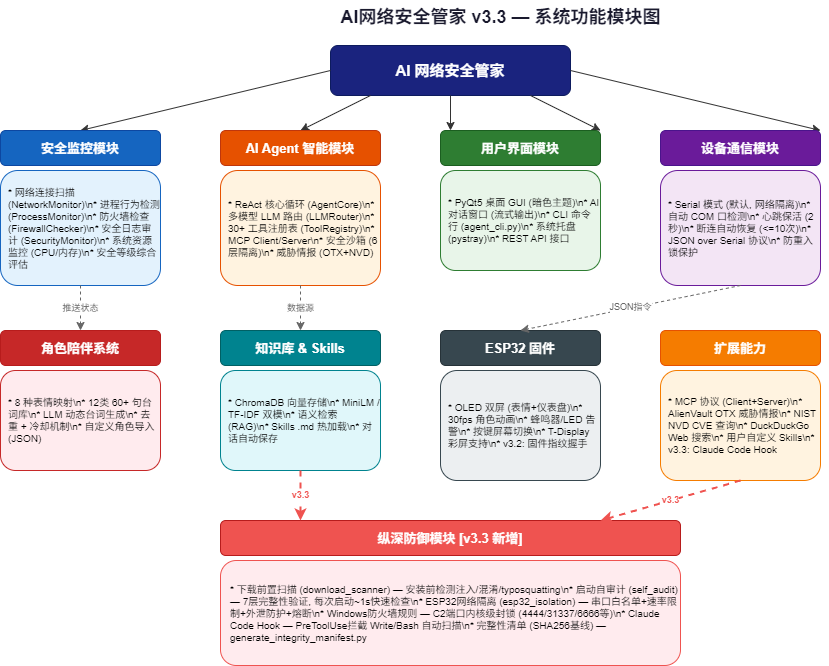

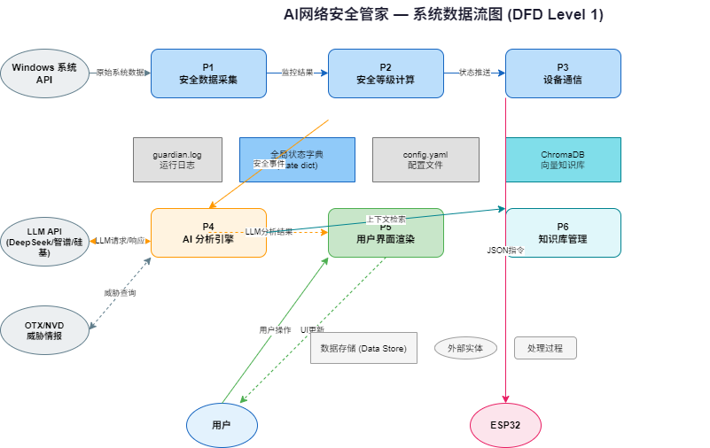

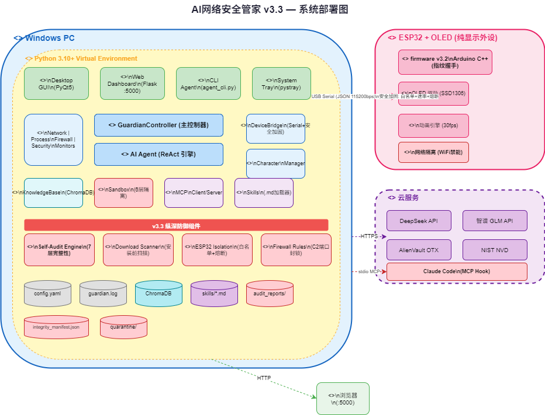

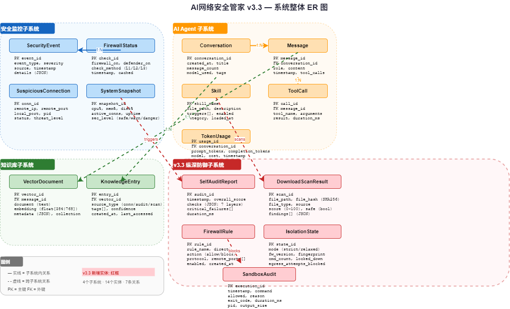

---

## 🔌 通信协议

PC Agent 与 ESP32 通过 JSON over Serial (115200bps) 通信：

**状态更新:**
```json
{
  "cmd": "update",
  "sec_level": "safe",
  "threat_count": 0,
  "active_connections": 42,
  "suspicious_ips": 0,
  "firewall_on": true,
  "defender_on": true,
  "cpu_usage": 23.5,
  "mem_usage": 45.2,
  "messages": ["一切正常"]
}
```

**紧急告警:**
```json
{"cmd": "alert", "message": "检测到可疑连接: 192.168.1.100:4444"}
```

**角色指令:**
```json
{"cmd": "expression", "expression": 4}
{"cmd": "say", "text": "主人! 防火墙怎么关了!"}
{"cmd": "screen", "screen": 1}
```

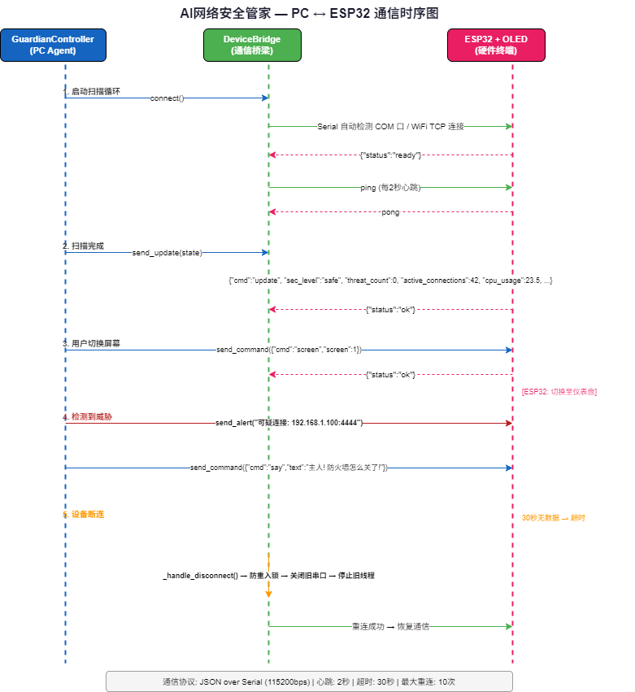

---

## ⚙️ 配置说明

编辑 `pc_agent/config.yaml`：

```yaml
# 设备连接
device:
  mode: serial         # serial (推荐, 网络隔离) | wifi | none
  serial:
    port: auto
    baudrate: 115200

# 安全监控
security:
  scan_interval: 5    # 扫描间隔(秒)
  network:
    suspicious_ports: [4444, 1337, 31337, 6666, 6667, 8080, 8888, 9001]
  process:
    suspicious_names: ["nmap", "mimikatz", "metasploit", "cobalt", ...]
    cpu_threshold: 80
    mem_threshold: 80

# 大模型 API —— 三家都可选，配了哪家启哪家；
# 配多家时会按 priority 自动故障转移（数字小的先试）
llm:
  enabled: true
  deepseek:
    enabled: true
    api_key: "${DEEPSEEK_API_KEY}"
    model: "deepseek-chat"          # 可选 deepseek-reasoner
  zhipu:
    enabled: false
    api_key: "${ZHIPU_API_KEY}"
    model: "glm-4-flash"            # 免费额度
  siliconflow:
    enabled: false
    api_key: "${SILICONFLOW_API_KEY}"
    model: "deepseek-ai/DeepSeek-V3"

# MCP 服务器 (扩展工具, 安装前自动安全扫描)
mcp_servers: []

# 知识库
knowledge_base:
  enabled: true
  top_k: 3

# Agent 编排 (可选；不写就用下面的默认值)
agent:
  max_iterations: 10         # 单轮最多调用 LLM 几次
  history_limit: 20          # 送给模型的历史消息窗口
  approval_mode: interactive # interactive | auto_approve | auto_reject
  approval_required_tools: []  # 追加到工具自带审批标注之上的名单
  approval_timeout_seconds: 300
  checkpoint_backend: sqlite # sqlite(默认,崩溃可续跑) | memory(测试用)
  checkpoint_db_path: ""     # 空 = <项目根>/data/guardian_graph.sqlite
  kb_context_timeout: 4.0    # KB 检索超时预算(秒)；0 = 不限
```

> ⚠️ `pc_agent/config.yaml` **被 `.gitignore` 忽略且仓库里没有模板**，
> 新克隆下来可能完全没有这个文件。上面所有键的默认值都写在代码里
> （`agent/config.py`），因此缺文件也能跑；要改哪项就自己建一份。

---

## 🛠️ 技术栈

| 层 | 技术 | 说明 |
|---|---|---|
| **嵌入式** | Arduino C++ / ESP32 | 固件开发 |
| **显示驱动** | Adafruit SSD1306 + GFX / TFT_eSPI | OLED / TFT |
| **通信协议** | JSON over Serial (115200bps) / WiFi TCP | PC ↔ ESP32 |
| **PC Agent** | Python 3.10+ | 主控程序 |
| **系统监控** | psutil, pywin32, WMI | 进程/网络/事件日志 |
| **LLM** | OpenAI-compatible API | DeepSeek / 智谱 / 硅基流动 |
| **Agent 编排** | LangGraph 1.x (LTS) + langchain-core | 状态图 + 检查点 + 人工中断 |
| **图状态持久化** | SQLite (langgraph-checkpoint-sqlite) | 崩溃后可按 thread_id 续跑 |
| **桌面 GUI** | PyQt5 + QSS | 暗色极简主题 |
| **系统托盘** | pystray + Pillow | 后台运行 |
| **知识库检索** | 自研 CJK bigram BM25 | 进程内、零依赖，Markdown 为事实源 |
| **MCP 协议** | JSON-RPC 2.0 | 工具扩展 |
| **威胁情报** | AlienVault OTX + NIST NVD | 免费 API |
| **搜索** | DuckDuckGo Lite | 免费无 Key |
| **安全沙箱** | 命令白名单 + Job Object + 超时/截断 + 审计日志 | 文件守卫与受限令牌层未实现 |
| **自审计** | SHA256 哈希 + 依赖扫描 + 代码注入检测 | 启动跑 quick_check，--full 跑完整审计 |
| **网络隔离** | 串口白名单 + 防火墙 C2 封锁 + 外泄防护 | ESP32 零网络暴露 |
| **前置扫描** | Regex 模式库 + Unicode 隐藏检测 + Typo 检测 | 安装前自动拦截 |
| **测试** | pytest + unittest.mock | 单元测试 |

---

## 🤝 MCP 集成

Guardian 实现了完整的 MCP (Model Context Protocol) 支持，可以与其他 AI 工具互操作：

### 作为 MCP Client (调用外部工具)

```yaml
# config.yaml
mcp_servers:
  - name: my-tools
    transport: stdio
    command: "python -m my_mcp_server"
  - name: remote-api
    transport: http
    url: "http://localhost:9000/mcp"
```

### 作为 MCP Server (被外部调用)

```bash
# 将 Guardian 的安全工具暴露给 Claude Code 等外部客户端
python -m agent.mcp_server_mode
```

在 Claude Code 中配置：
```json
{
  "mcpServers": {
    "guardian": {
      "command": "python",
      "args": ["-m", "agent.mcp_server_mode"],
      "cwd": "/path/to/ai-security-guardian"
    }
  }
}
```

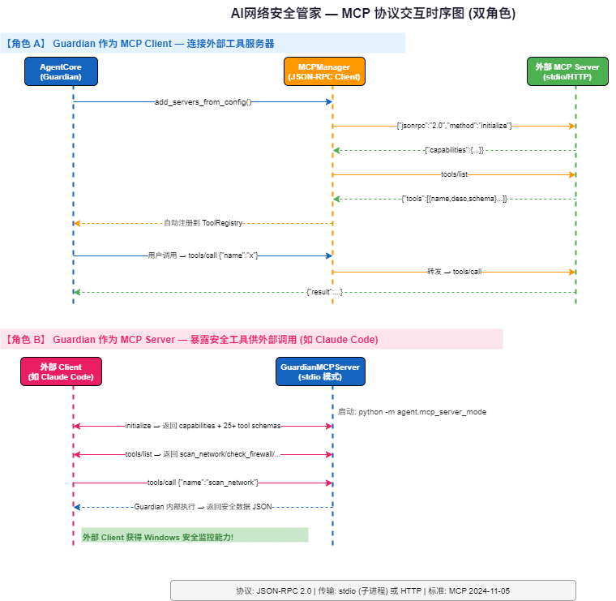

---

## 🧪 运行测试

```bash
pytest tests/ -v
```

---

## 🐛 故障排除

### ESP32 未连接
1. 检查 USB 线是否支持数据传输 (不是纯充电线)
2. 检查设备管理器中的 COM 端口号
3. 手动指定端口: `config.yaml` → `device.serial.port: COM3`

### 屏幕不显示
1. T-Display 无需接线；确认开发板型号选对（ESP32 Dev Module + TFT_eSPI 配置）
2. `TFT_eSPI` 的 `User_Setup.h` 需按 T-Display 的引脚配置（ST7789 / 135×240）
3. 串口监视器波特率设为 115200，能看到启动指纹即说明固件在跑

### LLM 调用失败
1. 检查 API Key 是否正确设置
2. 检查网络是否能访问对应 API 端点
3. 查看 `guardian.log` 获取详细错误信息
4. 不配置 LLM 也可使用基础监控功能

### 部分功能不可用
- 需要 **管理员权限** 运行: 安全事件日志、Defender 详细信息、进程终止
- 右键启动程序 → "以管理员身份运行"

---

---

## 🛡️ 纵深防御体系 (v3.3)

```
外部攻击面
    │
    ▼
┌─────────────────────────────────────────────┐
│ 第 0 层: 下载前置扫描                         │
│   Claude Code Hook → download_scanner       │
│   拦截: 提示注入 / 隐藏 Unicode / curl|bash  │
├─────────────────────────────────────────────┤
│ 第 1 层: 启动自审计                           │
│   GuardianController → quick_check (~1s)    │
│   验证: 文件哈希 / 依赖 / 配置 / 运行时       │
├─────────────────────────────────────────────┤
│ 第 2 层: ESP32 网络隔离                       │
│   DeviceBridge → cmd_validator + egress_grd │
│   Windows Firewall → C2 端口内核级封锁       │
├─────────────────────────────────────────────┤
│ 第 3 层: 命令沙箱                             │
│   白名单 → Job Object → 超时/截断 → 审计      │
├─────────────────────────────────────────────┤
│ 第 4 层: AI Agent 守则 + 人工闸门             │
│   系统提示词 + Skill 匹配 + 33 工具           │
│   敏感工具执行前 interrupt() 等用户批准        │
├─────────────────────────────────────────────┤
│ 第 5 层: 事后审计                             │
│   self_audit --full (7 项, ~3s)             │
│   定期验证 + 异常熔断                          │
└─────────────────────────────────────────────┘
```

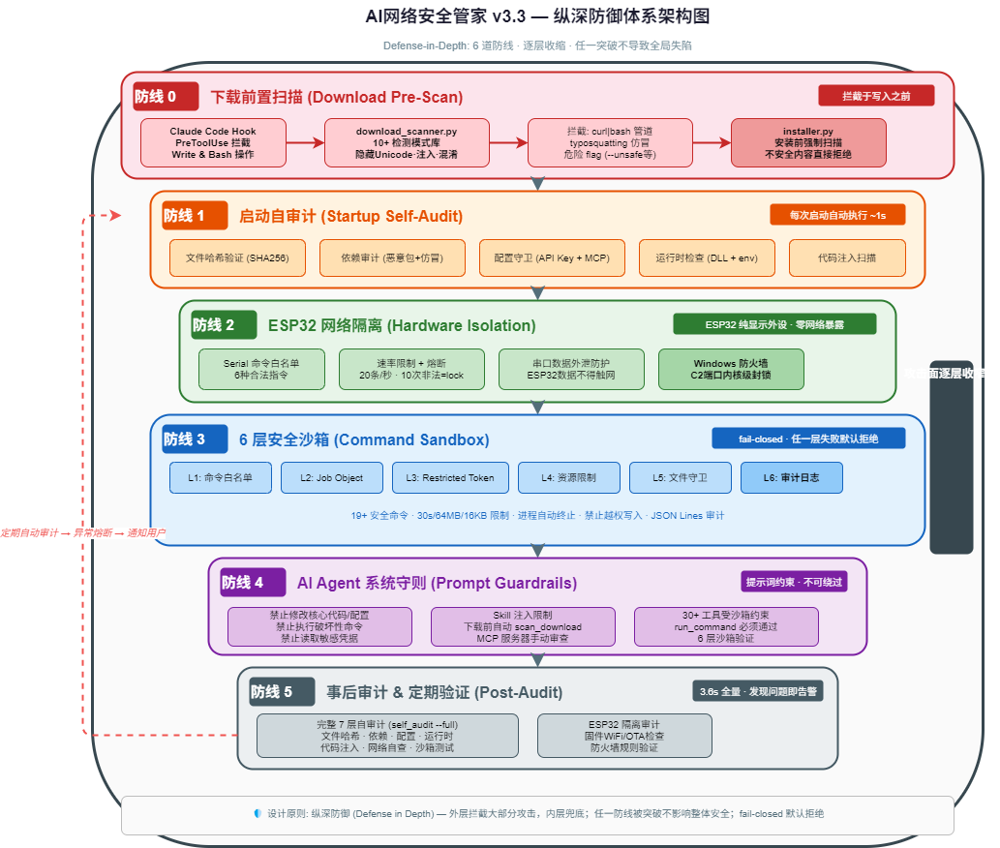

---

## ⚠️ 已知限制

把话说在前面。这些是当前代码的**真实状态**，不是路线图：

| 项 | 状态 |
|---|---|
| **受限令牌层 (Restricted Token)** | **经评估不做**，不是"待办"。实测：非提权进程调用 `CreateRestrictedToken` 直接返回 `ERROR_PRIVILEGE_NOT_HELD(534)`（即使 `flags=0`）——连令牌都建不出来；真正执行还需 `CreateProcessAsUser`（要 `SeAssignPrimaryTokenPrivilege`，仅管理员持有），且得用 ctypes 重写一遍进程创建（管道、环境块）。写一堆无法在本机验证的提权代码，正是这个项目一直在清理的那类问题。当前用 Job Object + 命令白名单覆盖主要风险 |
| **文件写入守卫** | `ALLOWED_WRITE_PATHS` 已删除 —— 定义了但零引用的常量容易让人误以为有这层防护 |
| **知识库检索** | 纯中文 BM25：强于精确术语，弱于同义改写/跨语言检索。本项目不做向量召回，也不依赖任何嵌入服务 |
| **SQLite 检查点** | 用 `sqlite-vec` 扩展；个别精简版 Python 可能装不上，届时自动降级为内存模式（重启不可续跑） |
| **平台** | 仅 Windows。`pywin32` / `ctypes.windll` / PowerShell 大量使用，Linux/macOS 需要移植 |
| **技能触发匹配** | 启发式而非语义匹配：连续子串优先，中文允许字符按序散落（「扫描我的网络」能命中 `network_scan`），两字触发词只做连续匹配。没有做分词或向量相似度 |

## 🗺️ 路线图

- [x] LangGraph 状态图编排 — 合并 CLI 与 GUI 两套手写 ReAct
- [x] 敏感工具人工审批闸门 — `interrupt()` + SQLite 检查点，崩溃可续跑
- [x] 多 provider 自动故障转移 — DeepSeek / 智谱 / 硅基流动
- [x] 运行时自审计 — 启动自检 + 完整审计，且不再有硬编码的假通过
- [x] ESP32 网络隔离 — 纯显示外设，零网络暴露
- [x] 下载前置扫描 — Skill/MCP/插件安装前自动安检
- [x] 技能触发匹配 —— 子串 + 中文子序列双档，取代原来的「第一个子串命中即返回」
- [x] 终止可疑进程工具 —— 走审批闸门，并硬拒系统关键进程
- [x] 启动熔断（opt-in）—— 自检发现 CRITICAL 可拒绝启动
- [ ] 角色自定义编辑器 (GUI)
- [ ] Linux/macOS 跨平台支持
- [ ] 移动端 App (查看远程安全状态)
- [ ] 社区技能市场

---

## 📜 许可证

MIT License — 自由使用、修改、分发

---

## 🙏 致谢

- ESP32 & Arduino 社区
- Adafruit SSD1306 / GFX 驱动库
- psutil 系统监控库
- AlienVault OTX 免费威胁情报
- NIST NVD 免费漏洞数据库
- PyQt5 桌面框架
- 智谱 AI、DeepSeek

---

**🛡️ 保护你的数字世界，从一个微小的设备开始。**

> *"安全不该是冷冰冰的警告弹窗，而是一个有温度的伙伴。"* — 安小盾
